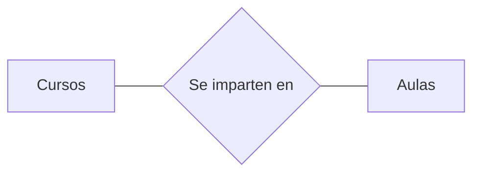
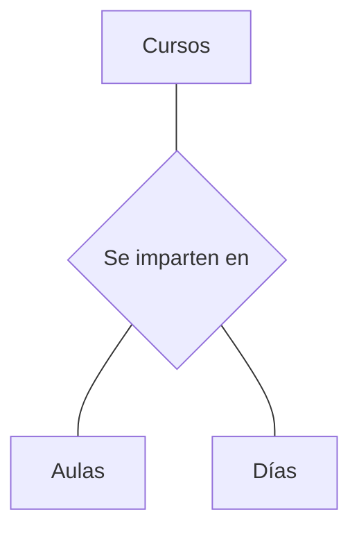
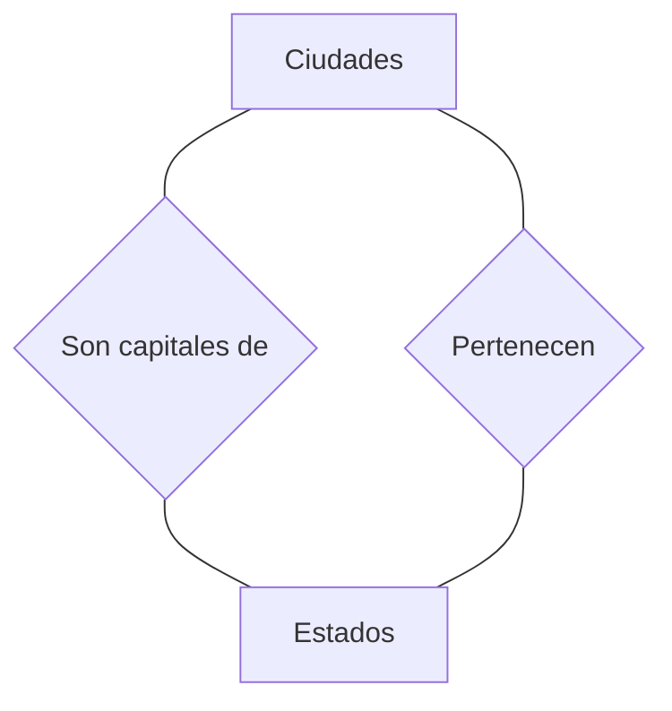
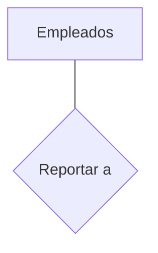

# Requerimientos operacionales de las bases de datos
## Dominio
Describe un conjunto de valores posibles para cierto atributo o campo   
Por lo tanto, un dominio puede restringir los valores de un atributo    
Dominio -> Tipo de dato -> Atributo     
Cada tabla puede tener uno o más campos cuyos valores identifican de forma única cada registro de la tabla      
No pueden existir dos o más registros diferentes cuyos valores en dichos campos sean idénticos      
A este conjunto de campos se les llama llave (normalmente primaria)     
## Llave primaria 
Al campo o campos (si fuera compuesta), se le llama llave única cómo la elegida que define unívocamente a todos los demás atributos de la tabla     
Estas llaves sirven para especificar los datos que serán relacionados con las demás tablas
## Llave foránea
Es una referencia a una llave en otra tabla     
Determina la relacion existente en dos tablas   
Las llaves foráneas no necesitan ser llaves únicas en la tabla donde están y sí a donde están referenciadas     
### Ejemplo
El código de departamento puede ser una llave foránea en la tabla de empleados      
Puede haber varios empleados en un mismo departamento       
Pero habría uno y solo un departamento en la tabla de departamentos     
## Llave índice
Surgen con la necesidad de tener un acceso más rápido a los datos       
Los índices pueden ser creados con cualquier combinación de campos de una tabla     
Las bases de datos relacionales incluyen múltiples técnicas de ordenamiento, cada una de ellas es óptima para cierta distribución de datos y tamaño de la relación      
Los indices generalmente no se consideran parte de la base de datos, pues son un detalle agregado   
## Integridad
Integridad = consistencia de los datos + validez
Sobre todo en ambientes multiusuarios

Algunos manejadores pueden monitorear posibles violaciones a la integridad      
Si una violación es detectada, se debería:
Rechazar la operacion causante, reportar y regresar a la base a un estado consistente (si se aplica)
## Integridad de dominio
Mantener valores correctos de los atributos o campos    
Es básicamente la definición del tipo de dominio    
- Debe ser lo más precisa posible para evitar violaciones
- La mayoria de los manejadores sólo proveen tipos simples para los dominios    
Las restricciones de dominio sirven para validar la información contenida en cada atributo y verificar que tengan sentido las comparaciones de campos
### Ejemplos 
#### Ej.1 
- Verificar que los valores que pertenecen a la llave primaria no sean nulos
#### Ej.2
- Es posible definir: DOMINIO DOM_EDAD = ENTERO
- Es más conveniente definirlo como: DOMINIO DOM_EDAD = ENTERO-POSITIVO 
- Y mejor como: DOMINIO DOM_EDAD = ENTERO-POSITIVO:[0-150]
#### Ej.3
- Varios atributos pueden tener el mismo dominio: NOMBRE de ALUMNO y de PROFESOR
- De modo práctico estos dominios se definen como cadenas de caracteres
- Suponga que también se define el NOMBRE de MATERIA como unna cadena de caracteres
- Surge un problema, aunque desde el punto de vista técnico se pueden comparar las cadenas que representan al NOMBRE de ALUMNO, con NOMBRE de MATERIA, no son comparables desde los dominios 
- En el caso de comparar contra el nombre de un PROFESOR no es problema, ya que el PROFESOR también sea ALUMNO
## Integridad intra-relacion
Verificar su validez entre valores de los atributos o campos de una relación y el mantenimiento de llaves únicas    
Cuando se agrega o modifica una tupla, no debe existir otra con los mismos valores en todos sus atributos
## Integridad semántica intra-relación
Verificar la consistencia entre los valores de dos atributos de cada tupla
Debe fundamentarse en el análisis sobre el significado de los atributos dentro del dominio de aplicación, es decir, esn el significado de las interrelaciones entre atributos
### Ejemplo 
Dados los atributs EDAD y ANTUGUEDAD de una tabla con datos de profesores,
Deben cumplir con la restricción EDAD > ANTIGUEDAD      
O EDAD > ANTIGUEDAD + C     
Donde C es un valor constante que es la edad minima a la que un profesor comienza a laburar
## Integridad referencial
Mantener la validez y consistencia entre relaciones     
De manera general, se busca asegurar que un valor que aparece en una relación también aparezca en otra      
La cardinalidad de asignación también es una restricción de integridad
- Las cardinalidades 1:1, N:1 o N:M que se definen en un model, deben de mantenerse en la implementación    
Por ejemplo, una relacion con cardinalidad 1:1 no puede contener dos tuplas con los mismos valores en los atributos de la llave foránea
## Independencia de Datos
Es la capacidad de modificar la definicion de un esquema sin afectar la definición de un nivel superior     
Independencia Lógica
- Modificar el esquema conceptual sin provocar que se necesiten escribir los programas de aplicación.

Independencia física
- Modificar el esquema fisico sin provocar que se necesiten escribir los programas de aplicacion

La independencia lógiva es más difícil de lograr que la fisica, pues los programas de aplicacion son fuertemente dependientes de los datos que acceden
## Autorizaciones
Determinar quien puede ver o hacer cierta operacion sobre los datos     
En los DBMS, hay una relacion estrecha entre autorizacion y vistas      
El esquema de vistas funciona bien si el usuario consulta, pero al momento de hacer cambios, el esquema topa con límites, aveces insuperables
## Control de concurrencia
Es cuando varios usuarios consultan o actualizan la base de datos       
Es posible que no se conserve la consistencia de datos      
El SMDB debe controlar estas ocurrencias, haciendo suponer al usuario como si estuviera trabajando de manera aislada    
Uno de los mejores para controlar la concurrencia es el manejo de bloqueos

# Normalización
## Proposito de la normalizacion
Proceso que se aplica una serie de reglas, que evidencian las relaciones entre los datos, con el propósito de minimizar la redundancia y gestión de datos   
Existen 5 formas normales, pero lo común es llegar hasta la tercera
## PFN (Primera Forma Normal)
Evita elementos o grupos repetidos. Busca 
- Atomicidad - Una fila no puede contener grupos repetidos de datos similares
- Unicidad - Cada fila tiene que tener un único identificador (o llave primaria)
## SFN (Segunda Forma Normal)
Sin dependencias parciales de llaves concatenadas. Busca
- Para una tabla que tiene una llave primaria concatenada, cada columna de la tabla, que no forma parte de la llave primaria, tiene que depender de la llave concatenada completamente
- Si hay alguna columna que solamente dependa de una parte de la llave concatenada, entonces decimos que la tabla completa no cumple la SFN y tenemos que crear otra tabla para rectificar el fallo
## TFN (Tercera Forma Normal)
Sin dependencias de atributos que no son llaves. Busca
- Mantener lo esencial en cada tabla 
# Entidad relacion
## Generalidades del modelo E-R
El modelo lógico llamado como entidad/relacion permite describir los datos a nivel conceptual y visual  
Conecta objetos basicos entendidos como las entidades y sus relaciones, teniendo en cuenta su caridad. El diagrama definido por Peter Chen 1976     
Es una herramiebta para entender la estructura de la base sin tener detalle de la estructura
## De manera formal
Dados los conjuntos D1, D2, ..., Dn, se dice que la relación R sobre estos n conjuntos es un conjunto de n elementos ordenados (d1, d2, ..., dn) tales que d1 ∈ D1, d2 ∈ D2, ..., dn ∈ Dn
- Los conjuntos D1, D2, ...,Dn son los dominios de R
- El valor n es el grado de R
## Tipos de relaciones
* ### Relación binaria

* ### Relación terciaria.

* ### Relación doble.

* ### Relación reflexiva.

## Cordinalidad
Para las relaciones binarias, es el numero de entidades con las que puede asociarse otra entidad, dentro de un conjunto de relaciones. Si A y B son conjuntos de entidades, la cardinalidad de asignacion de un conjunto de relaciones entre ellas, puder ser:  
- 0:1 Si la entidad a ∈ A puede o no estar asociada con una b ∈ B y la entidad b ∈ B está asociada a lo más con una a ∈ A   
  Policías y Armas, un policía tiene un arma siempre y cuando no realice funciones de oficina.
- 1:1 Si la entidad a ∈ A está asociada a lo más con una b ∈ B y la entidad b ∈ B está asociada a lo más con una a ∈ A      
  Profesores y Departamentos, un profesor solo puede ser jefe de un departamento y un departamento solo puede tener un jefe.
- 1:N Si la entidad a ∈ A está asociada a lo más con una b ∈ B y la entidad b ∈ B está asociada con un número cualquiera de entidades a ∈ A.
  Vendedores y Ventas, un vendedor puede tener muchas ventas pero una venta solo puede tener un vendedor
- N:M Si la entidad a ∈ A está asociada con un número cualquiera de entidades b ∈ B y la entidad b ∈ B está asociada con un número cualquiera de entidades a ∈ A
  Asociaciones y Ciudadanos, donde muchos ciudadanos pueden pertenecer a una misma asociación, y cada ciudadano puede pertenecer a muchas asociaciones distintas
## Conectores
- 0: Si cada instancia de la entidad no está obligada a participar en la relación
- 1: Si toda instancia de la entidad no está obligada a participar den la relación y solamente participa una vez
- N, M, ó * Si cada instancia de la entidad no está obligada a participar en la relación y puede hacerlo cualquier número de veces
